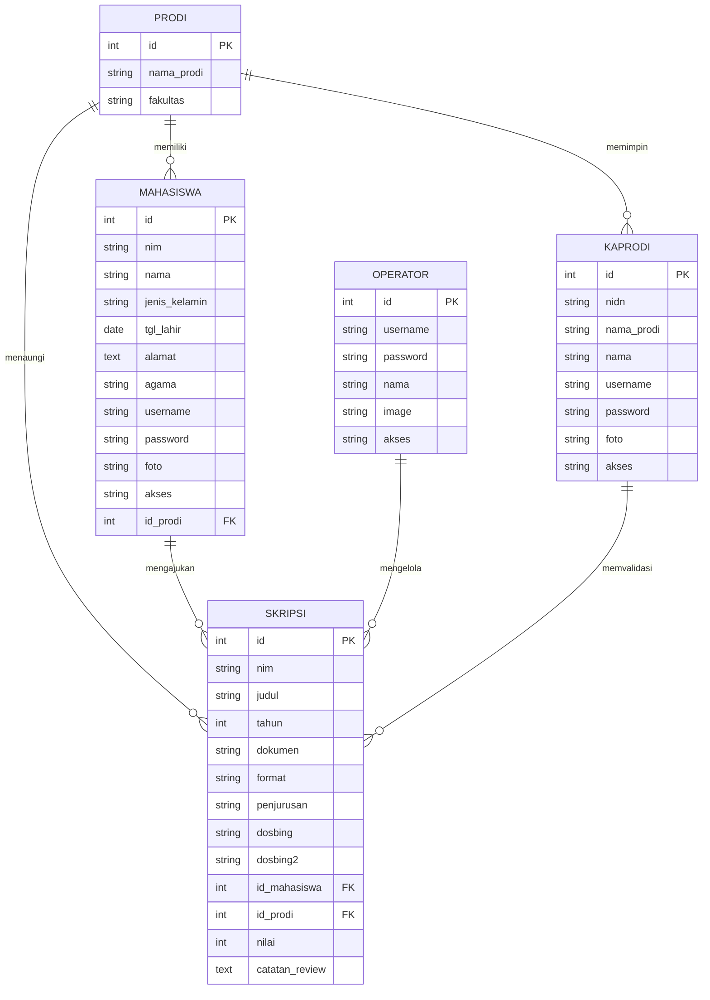

<p align="center">
  
</p>

<h1 align="center">E-SKRIPSI FMIPA UNIVERSITAS PAKUAN</h1>
<h3 align="center">Sistem Informasi Digital Library Skripsi Berbasis Website</h3>

<p align="center">
  <em>Repositori Karya Ilmiah dan Perpustakaan Digital Mahasiswa FMIPA Universitas Pakuan</em>
</p>

<p align="center">
  
  
  
  
  
  
</p>

---

## 📌 Ringkasan Akademik

* **Judul Tugas Akhir / Praktik Lapang:** Sistem Informasi Digital Library Skripsi Berbasis Website (Studi Kasus: Perpustakaan MIPA UNIVERSITAS PAKUAN)
* **Penulis:** Faris Raja Ardana
* **NPM:** 065120125
* **Program Studi:** Ilmu Komputer
* **Fakultas:** Matematika dan Ilmu Pengetahuan Alam (FMIPA)
* **Perguruan Tinggi:** Universitas Pakuan, Bogor
* **Dosen Pembimbing I:** Teguh Puja Negara, M.Si., S.Si.
* **Dosen Pembimbing II:** Endang Suhendar, M.Kom.
* **Dosen Penguji I:** Dinar Munggaran A, M.Kom.
* **Ketua Program Studi:** Arie Qur’ania, M.Kom.

---

## 📖 Latar Belakang Masalah

Pengelolaan naskah skripsi fisik pada rak perpustakaan konvensional memiliki berbagai keterbatasan:
1. **Risiko Kerusakan & Kehilangan Arsip Fisik:** Dokumen cetak rentan lapuk, rusak, atau terselip.
2. **Keterbatasan Akses Pemustaka:** Mahasiswa harus hadir secara fisik di ruang perpustakaan hanya untuk mencari referensi judul skripsi terdahulu.
3. **Pencatatan & Pelaporan yang Tidak Efisien:** Pengolahan data peminjaman dan rekapitulasi naskah yang masih manual menyulitkan staf perpustakaan dalam menyajikan laporan akurat untuk pengambilan keputusan prodi.

**E-SKRIPSI** hadir sebagai solusi digital terintegrasi yang memungkinkan pengarsipan naskah naskah tugas akhir secara terpusat, memfasilitasi mahasiswa dalam mengunggah skripsi mandiri (PDF), memudahkan Ketua Program Studi dalam mereview naskah, serta menyediakan katalog online yang dapat diakses kapan saja dan di mana saja.

---

## 🚀 Fitur Unggulan Sistem

### 1. 🎓 Modul Mahasiswa
* **Registrasi Mandiri:** Pendaftaran akun baru dengan validasi NIM, Program Studi, data diri lengkap, serta upload foto profil.
* **Form Unggah Skripsi ("Kirim Skripsi"):** Mengunggah naskah tugas akhir lengkap dengan metadata (NIM, Judul, Tahun, Format, Bidang Penjurusan, Dosen Pembimbing 1 & 2, serta file PDF hingga 30 MB).
* **Hasil Review & Tracking:** Pemantauan status persetujuan (*Pending*, *Disetujui*, atau *Perlu Revisi*) secara transparan beserta catatan arahan dari Kaprodi/Operator.
* **Katalog Skripsi:** Pencarian dan pembacaan naskah referensi dari angkatan sebelumnya.
* **Manajemen Profil:** Pengubahan biodata serta pembaruan kata sandi akun.

### 2. 👨‍🏫 Modul Dosen / Kaprodi (Reviewer)
* **Dashboard Analitik:** Statistik naskah skripsi terarsip, pengajuan pending, naskah disetujui, dan jumlah mahasiswa aktif.
* **Grafik Visual Interaktif (Chart.js):**
  - Diagram Batang: Tren jumlah pengajuan skripsi tahunan.
  - Diagram Lingkaran: Proporsi distribusi konsentrasi keilmuan (*Rekayasa Perangkat Lunak, Jaringan, Data Mining/AI, Multimedia, Sistem Informasi*).
* **Lembar Evaluasi & Validasi:** Pemeriksaan naskah PDF secara langsung, penentuan status validasi skripsi, serta penyampaian catatan revisi ke mahasiswa.
* **Rekapitulasi Laporan:** Monitoring judul skripsi mahasiswa di bawah program studinya.

### 3. ⚙️ Modul Operator / Admin (Staf Perpustakaan)
* **Master Data Skripsi:** Pengelolaan penuh terhadap seluruh naskah skripsi mahasiswa (verifikasi, pratinjau, edit, unduh berkas PDF, hapus).
* **Master Data Pengguna:** Manajemen akun Mahasiswa (tambah manual, reset data) dan akun Dosen/Kaprodi.
* **Tabel Interaktif (DataTables.net):** Pencarian instan (*live filter*), pengurutan kolom (*column sorting*), serta paginasi data otomatis.
* **Cetak Laporan Resmi:** Dilengkapi **Kop Surat resmi Fakultas MIPA Universitas Pakuan**, filter tahun akademik & penjurusan, serta tanda tangan pengesahan siap cetak atau simpan ke PDF.
* **Dialog Konfirmasi Interaktif (SweetAlert2):** Proteksi aksi sensitif seperti penghapusan data atau perubahan status validasi.

### 4. 📚 Modul Digital Library Publik (Katalog)
* **Pencarian Cepat (*Live Multi-Query*):** Pencarian naskah berdasarkan kata kunci, judul, nama mahasiswa, NIM, atau dosen pembimbing.
* **Penyaring Cerdas (*Filter*):** Filter spesifik berdasarkan tahun kelulusan dan bidang peminatan.
* **Penampil Dokumen (*Built-in PDF Viewer*):** Pratinjau dokumen PDF langsung di halaman tanpa harus mengunduh terlebih dahulu.
* **Generator Sitasi Otomatis:** Menghasilkan sitasi karya ilmiah dalam standar **APA (American Psychological Association) 7th Edition** siap salin dengan 1 klik.

---

## 🏗️ Arsitektur & Teknologi

Sistem dibangun menggunakan arsitektur **MVC (Model-View-Controller)** yang terstruktur, ringan, dan aman:

```
digital-library-unpak/
├── app/
│   ├── Controllers/       # Pengendali logika alur (Auth, Mahasiswa, Operator, Kaprodi, Library)
│   ├── Helpers/           # Otentikasi session (Auth.php) dan validasi upload (Upload.php)
│   └── Models/            # Model data PDO (Operator, Mahasiswa, Kaprodi, Skripsi, Prodi)
├── config/
│   └── database.php       # Konfigurasi koneksi PDO MySQL & auto-migration fallback
├── views/
│   ├── layouts/           # Template utama (header, sidebar, footer)
│   ├── auth/              # Halaman Login 3 Role dan Registrasi Mahasiswa
│   ├── mahasiswa/         # Dashboard, Kirim Skripsi, dan Hasil Review
│   ├── operator/          # Dashboard Data Skripsi, Mahasiswa, Kaprodi, dan Laporan Resmi
│   ├── kaprodi/           # Dashboard Analitik dan Lembar Validasi Naskah
│   └── library/           # Katalog Publik Kumpulan Skripsi & PDF Reader Detail
├── assets/
│   ├── css/               # Bootstrap 5.3, Bootstrap Icons, DataTables CSS, Custom Theme UNPAK
│   ├── js/                # Bootstrap Bundle, jQuery 3.7, DataTables, Chart.js, SweetAlert2
│   └── img/               # Logo resmi UNPAK, hero illustration, avatar
├── uploads/
│   ├── skripsi/           # Penyimpanan fisik file naskah PDF
│   └── profiles/          # Penyimpanan foto profil pengguna
├── database.sql           # Skema DDL dan DML data awal (seeds)
├── install.php            # Antarmuka web instalasi & migrasi database mandiri
├── index.php              # Master router & entry point aplikasi
└── README.md              # Dokumentasi lengkap proyek
```

---

## 🗄️ Rancangan Basis Data (Spesifikasi Tabel)

Sistem menggunakan basis data relasional **MySQL / MariaDB** dengan *Storage Engine* **InnoDB**:



---

## 💻 Panduan Instalasi & Menjalankan

### Kebutuhan Perangkat Lunak:
* **PHP:** Versi 8.0 ke atas (diuji optimal pada PHP 8.2) dengan ekstensi `pdo_mysql`, `mbstring`, `fileinfo`.
* **Database:** MySQL 5.7+ / MySQL 8.x atau MariaDB.
* **Web Server:** Apache / Nginx (Laragon, XAMPP) atau PHP Built-in Server.

---

### Cara 1: Menggunakan Laragon (Direkomendasikan)
1. Salin atau *clone* repositori ini ke folder:
   ```text
   C:\laragon\www\digital-library-unpak
   ```
2. Buka aplikasi **Laragon**, lalu klik tombol **Start All**.
3. Buka browser dan jalankan script inisialisasi database otomatis:
   ```text
   http://localhost/digital-library-unpak/install.php?run=install
   ```
4. Buka aplikasi di:
   ```text
   http://localhost/digital-library-unpak
   ```
   *(Atau `http://digital-library-unpak.test` jika Pretty URL Laragon aktif).*

---

### Cara 2: Menggunakan XAMPP
1. Salin folder proyek ke direktori:
   ```text
   C:\xampp\htdocs\digital-library-unpak
   ```
2. Nyalakan service **Apache** dan **MySQL** melalui XAMPP Control Panel.
3. Buka browser dan akses `http://localhost/digital-library-unpak/install.php?run=install`.
4. Sistem siap digunakan di `http://localhost/digital-library-unpak`.

---

### Cara 3: Menggunakan PHP Built-in Server (Terminal)
1. Buka PowerShell / Terminal di direktori proyek:
   ```bash
   cd digital-library-unpak
   ```
2. Pastikan service MySQL lokal Anda sudah aktif pada port 3306.
3. Jalankan server lokal:
   ```bash
   php -S localhost:8000
   ```
4. Akses melalui browser pada alamat `http://localhost:8000`.

---

## 🔑 Akun Uji Coba Default

Sistem telah dilengkapi dengan *dummy data* bawaan yang siap dicoba tanpa perlu menginput ulang data dari nol:

| Role / Peran | Username / Identifier | Password Default | Nama Pengguna | Deskripsi Peran |
| :--- | :--- | :--- | :--- | :--- |
| **Mahasiswa** | `faris` *(atau NIM: `065120125`)* | `password123` | Faris Raja Ardana | Akses kirim skripsi & hasil review |
| **Dosen / Kaprodi** | `kaprodi` *(atau NIDN: `0412088501`)* | `password123` | Arie Qur'ania, M.Kom. | Akses evaluasi & validasi naskah |
| **Operator / Admin** | `admin` | `password123` | Staf Perpustakaan FMIPA UNPAK | Akses kelola skripsi, user, & laporan |

> [!TIP]
> Pada halaman login telah disediakan tombol pintas (*quick autofill*) pada bagian bawah untuk mengisi kredensial di atas secara instan hanya dengan 1 klik.

---

## 📚 Format Sitasi Akademik (APA 7th)

Jika Anda merujuk pada sistem informasi atau naskah skripsi ini, gunakan format sitasi berikut:

```text
Ardana, F. R. (2023). Sistem Informasi Digital Library Skripsi Berbasis Website (Studi Kasus: Perpustakaan MIPA Universitas Pakuan) [Laporan Praktik Lapang, Universitas Pakuan]. Repositori FMIPA UNPAK.
```

---

## 📄 Lisensi & Hak Cipta

Proyek ini dikembangkan untuk keperluan akademik dan penelitian di lingkungan **Program Studi Ilmu Komputer, Fakultas Matematika dan Ilmu Pengetahuan Alam, Universitas Pakuan**.

Hak Cipta © 2023–2026 **Faris Raja Ardana (NPM: 065120125)**. Seluruh hak cipta dilindungi undang-undang.
